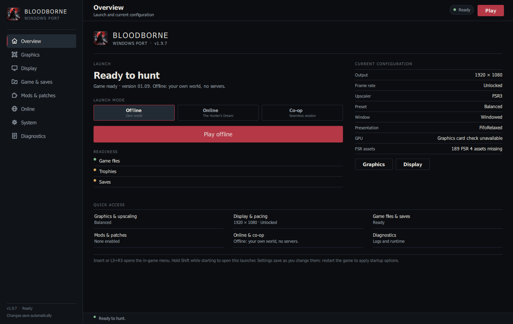
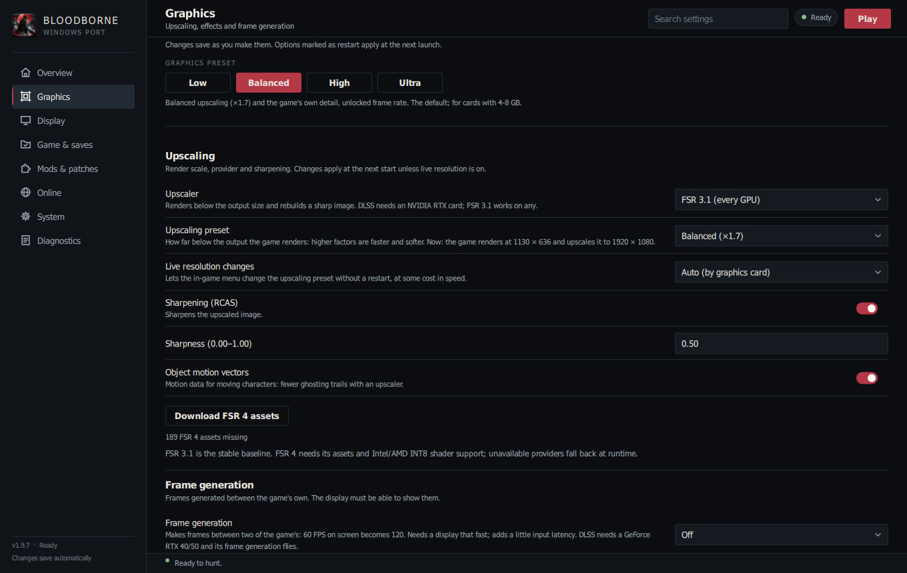
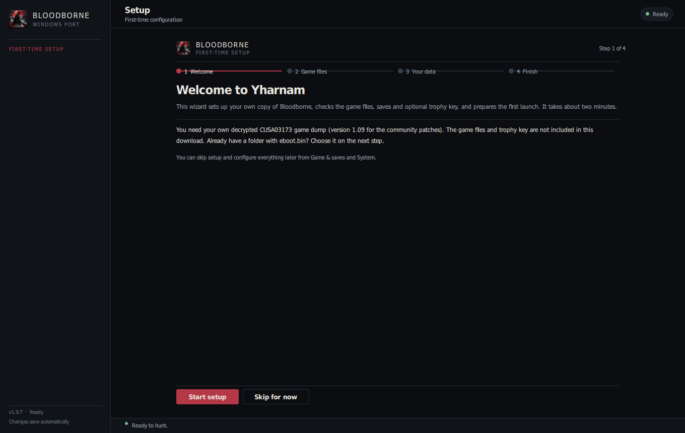

# Bloodborne for Windows (Jgamrot fork)

Run your own decrypted copy of Bloodborne (CUSA03173, version 1.09) natively on Windows 10 or 11.
The game's own code runs directly on your CPU and its graphics are translated to Vulkan. This
fork is based on [Supermedo's Windows port](https://github.com/Supermedo/bloodborne_pc) by
Mohammed Albarghouthi, which builds on [deadinside28's bbport](https://github.com/deadinside28/bloodborne_pc)
and the [shadPS4](https://github.com/shadps4-emu/shadPS4) renderer.

> **No game files are included.** You need your own dump of Bloodborne. This project is not
> affiliated with Sony Interactive Entertainment or FromSoftware.



## Download

From the [latest release](https://github.com/Jgamrot/bloodborne_pc/releases/latest), download
**[bbport-windows.zip](https://github.com/Jgamrot/bloodborne_pc/releases/latest/download/bbport-windows.zip)**
and extract the whole archive. The two **Source code** downloads are for developers. Previews
of upcoming features are marked *Pre-release* on the
[releases page](https://github.com/Jgamrot/bloodborne_pc/releases).

## Features

**Launcher and setup**
- A setup wizard on first start that installs the game from your own ZIP or PKG dump, checks
  the game files, saves and trophy key, and can be reopened from **Game & saves → Setup wizard**.
- Named pages: Overview, Graphics, Display, Game & saves, Mods & patches, Online, System and Diagnostics.
- Every setting from the old launcher is still available; startup options are marked as applying at the next launch.
- A live Diagnostics page shows process state, exit code, runtime facts, paths and the session log (copy, save or clear).
- `Play Bloodborne.exe` starts the game straight away with your saved settings.
- Update notifications for full releases.

**Graphics**
- NVIDIA DLSS (GeForce RTX 20 series and newer), AMD FSR 3.1 and FSR 4, native-resolution TAA.
- Output from 720p to 4K, fullscreen switchable while playing, 30/60/90 FPS or unlocked with a cap.
- The game's effects on or off: chromatic aberration, depth of field, motion blur, SSAO, the
  game's AA, dynamic shadows, screen-space reflections, model detail.
- Shader pre-build: shaders the game is known to use are built while it starts (*Preparing
  shaders* in the window title) instead of stuttering the first time an area or effect appears.
  The included catalog covers the game up to the Blood-starved Beast so far; it lists shaders,
  not game code, and each install builds them from its own files. Off with `BB_SHADER_PREBUILD=0`.



**In the game**
- PC settings in the game's own System menu: PC Graphics, Display, Effects, Settings and
  Gameplay, Achievements, and Restart to Apply. Quit Game on the title screen.
- The **Insert** / **L3+R3** guide: FPS, achievements with icons and Gamerscore, all settings,
  mods and cheats. Achievement toasts when a trophy unlocks.

**Controls**
- Controller, and keyboard and mouse at the same time, with rebindable keys
  (`key_<action>=` lines in `bbport.ini`).
- Mouse camera: click the game window and the mouse turns the camera 1:1. Sensitivity and
  invert Y are in **Game & saves → Mouse**.
- Keyboard movement smoothing: changing direction with WASD swings smoothly instead of
  stopping for a moment (**Game & saves → Keyboard**, *Off* to disable).
- Button prompts: PlayStation, Xbox (included) or keyboard keys (see below), switchable in the
  launcher and the guide.

**Optional enhancements** (off by default; switch them on in the launcher's **Mods & patches** page or
the guide. They are made from your own game files at start, which stay unchanged.)
- **Lamps: Level Up and Storage** (`pc_enhanced_lamps`): every lit lamp also offers the game's
  own level-up and storage screens, once you have used the Doll and the storage box.
- **Rebirth in the Nightmare** (`pc_rebirth`): reallocate your stats at the Altar of Despair.
- **Hunter's Dream mirror** (`pc_mirror_appearance`): the workshop mirror opens the appearance
  editor, the developers' unused "Put on Disguise".
- **Two invaders** (`pc_two_invaders`) in Mensis, Mergo's Loft, the Nightmare Frontier and the
  Old Hunters' areas. Every player in a session needs it on.

**Also**
- Online play (beta): messages, bloodstains and ghosts through
  [The Hunter's Dream](https://thehuntersdream.com), and co-op through a shadNet server.
- Death respawns skip the game's fixed 12-second wait.
- Mods and third-party patches, loaded without changing your game files.
- The Old Hunters on base-game dumps, with a DLC folder setting.

What changed in each release: [docs/CHANGELOG.md](docs/CHANGELOG.md).


## First-time setup

1. Right-click **bbport-windows.zip** and choose **Extract All**. Put the `bbport-windows`
   folder somewhere permanent, such as `C:\Games\Bloodborne\bbport-windows`. Do not run the game
   from inside the zip.
2. Double-click **Bloodborne.exe**. The setup wizard opens on a new install; **Skip setup** goes
   straight to the launcher.
3. In the wizard's **Game files** step, either:
   - click **Install from ZIP / PKG** and choose your dump (for example `cusa-03173.zip`) and a
     destination such as `C:\Games\Bloodborne`. The base game and the plain 1.09 update are
     extracted into `CUSA03173`; allow about 70 GB free for a 30 GB archive. Or
   - click **Choose a game folder** and pick the folder with `eboot.bin` directly inside.
4. On **Your data**, optionally import your own `keys.json` (for achievement names) or choose an
   existing saves folder. The checks turn green when the game folder has version 1.09; amber is
   normal for a new install without saves.
5. Click **Play**. The first launch prepares files and builds the known shaders
   (*Preparing shaders: N%* in the window title), so it takes a while; later starts are quick.



```text
C:\Games\Bloodborne\
├── bbport-windows\
│   ├── Bloodborne.exe
│   └── bin\bb-probe.exe
└── CUSA03173\                 ← the Game folder
    ├── eboot.bin
    ├── dvdroot_ps4\
    ├── sce_module\
    └── sce_sys\
```

If the launcher says **No eboot.bin**, you chose the wrong folder. If it reports version 1.00,
the 1.09 update did not apply.

**DLC.** The Game of the Year edition (CUSA03173) already includes The Old Hunters. With a
base-game dump, dump your add-ons too: each is a folder named like `SPEXPANSIONDLC03` with only
`sce_sys` inside. Put them in one folder and choose it as **DLC folder** on the **Game & saves** page.

**Achievements.** Names, descriptions and Gamerscore need the trophy key from your own PS4 in
`user\keys.json` (shadPS4's format, `{"TrophyKeySet":{"ReleaseTrophyKey":"..."}}`). Without it,
achievements show their numbers and icons. Nothing syncs to PlayStation Network.

## Keyboard button prompts

Choose **Keyboard** in the launcher (**Game & saves → Button prompts**). The key images are
[PCBButtons](https://www.nexusmods.com/bloodborne/mods/460) by **JinkiJinn**, included with the
port as its permissions allow; nothing needs downloading. Choosing it also sets your
keys to the ones the images show: E interact, Left Shift dodge, R blood vial, Q item,
F transform, left / right / middle mouse for attack / firearm / lock-on, Left Ctrl + left mouse
for strong attack, Space for L3, G and H for gestures and personal effects. Switch back to
PlayStation or Xbox in the launcher or the guide's **Mods** tab at any time.

## Wine and Proton

The launcher runs under Wine. On Wine/Proton the launcher selects Qt Quick's OpenGL backend
because Wine's Direct3D 11 path does not present page changes until a resize or fullscreen
toggle; native Windows keeps Direct3D 11. Proton 11.0 currently starts the classic Tk fallback
because its Wine ICU lacks the unversioned ICU DLLs Qt 6.12 imports. Details and the manual
regression procedure are in [docs/WINE_LAUNCHER_RENDERING.md](docs/WINE_LAUNCHER_RENDERING.md).

## Already have another launcher or game installation?

Keep your extracted game folder where it is; there is no need to extract it again.

1. Close the game and the old launcher, and back up the old launcher's `user` folder (saves,
   trophies, `keys.json`), its `bbport.ini` and its `mods` folder.
2. Extract this package to a **new** folder and run its `Bloodborne.exe`. Do not copy only
   `Bloodborne.exe` into an older port.
3. On **Game & saves**, set **Game folder** to your existing folder with `eboot.bin`, and **Saves folder**
   to your existing `user` folder (or copy your saves into the new one while everything is
   closed). Keep the backup until your character loads.
4. Copy over the mods you still want and enable them under **Mods & patches**.

## Launcher diagnostics

Open **Diagnostics** in the launcher for the current process state, last exit code, runtime
GPU/upscaler/presentation report, and the live session log. **Copy log**, **Save log…** and
**Clear log** are available together with the port/log/config folders. The log viewer colours
lines containing errors or warnings and can follow new output. For deeper launcher
diagnostics, start with `BB_LAUNCHER_DEBUG=1`; this writes page, window, frame and Qt/QML
messages to `%APPDATA%\bbport-launcher\launcher-debug.log` and is off by default.

## Settings for advanced users

Game settings are stored in `bbport.ini` and launcher settings in
`%APPDATA%\bbport-launcher\settings.json`. Environment overrides on the launcher's **System**
page take precedence:

| Setting | `bbport.ini` | Override |
|---|---|---|
| Lamps: Level Up and Storage | `pc_enhanced_lamps=1` | `BB_PC_LAMPS=1` |
| Rebirth | `pc_rebirth=1` | `BB_PC_REBIRTH=1` |
| Hunter's Dream mirror | `pc_mirror_appearance=1` | `BB_PC_MIRROR=1` |
| Two invaders | `pc_two_invaders=1` | `BB_PC_TWO_INVADERS=1` |
| Mouse camera | `mouse_camera=0` turns it off | `BB_MOUSE_CAMERA=0` |
| Mouse pointer in the game's menus | `mouse_menu=0` turns it off | `BB_MOUSE_MENU=0` |
| 12-second respawn wait | | `BB_RESPAWN_DELAY_FIX=0` restores it |
| Strict frame cap (no single frame faster than the cap) | | `BB_STRICT_FRAME_CAP=0` |
| High-FPS sprint fix | `sprint_fix=0` turns it off | `BB_SPRINT_FIX=0` |
| Ultrawide camera and centered HUD (non-16:9 outputs) | `output_res=16:9 size` | `BB_ASPECT=0` |
| Indirect dispatch guard (skips implausible GPU work counts) | | `BB_INDIRECT_GUARD=0` |
| Pad stick neutral and travel per controller (clone pads) | | `BB_PAD_CENTER_CAL=0`, `BB_PAD_DEADZONE`, `BB_PAD_CENTER` |
| Safe saves (write to a copy, then replace) | | `BB_SAFE_SAVES=0` |
| Xbox pads: Back + d-pad left/right for the touchpad halves | | `BB_PAD_BACK_COMBO=0` |
| Skip draws that cannot change anything | | `BB_SKIP_EMPTY_DRAWS=0` |
| All engine hooks (in-game menus and features) | | `BB_ENGINE_HOOKS=0` |

## Known issues

- Character creation could show a blank or ghosted preview on the first visit; 1.6.12 and 1.6.13
  previews include a fix that still needs confirming in play. Backing out and choosing New Game again
  restores it.
- Rebirth and two invaders have not been tested in play yet.
- Keep the frame cap at 120 FPS or lower. The sprint fix removes the known half-speed sprint
  above it, but higher caps are not tested yet.
- Areas and effects beyond the shader catalog (so far, after the Blood-starved Beast) still
  stutter briefly the first time while their shaders compile; later releases extend the catalog.
  On AMD and Intel GPUs most fragment shaders still compile in play. On a black screen, try
  **System → Maintenance → Clear shader cache**.
- Occasional "exploded" character faces: set **GPU readbacks** to **Precise** (System → Engine);
  it costs some speed.

## Requirements

- Windows 10 (1903 or later) or Windows 11, 64-bit, and a graphics card with Vulkan 1.3.
- An Intel Core 4th generation (Haswell, 2013) or newer, or an AMD Ryzen: the game uses
  instructions of the PS4's processor (AVX, BMI1, MOVBE, LZCNT). Intel 2nd and 3rd generation
  (Sandy and Ivy Bridge, many Xeon E5 v1/v2) run with those instructions translated, best effort;
  CPUs without AVX cannot run the game.
- About 6 GB of available memory (RAM plus page file), 10 GB for 1440p or 4K output.
- DLSS needs an NVIDIA GeForce RTX 20 series or newer; FSR works on other cards.

## Roadmap, help and source

- What is planned next: [docs/ROADMAP.md](docs/ROADMAP.md).
- Problems: open an [issue](https://github.com/Jgamrot/bloodborne_pc/issues) with your graphics
  card, what happened, `user\last_run.log`, and the launcher session log saved from
  **Diagnostics → Save log…** (or `%APPDATA%\bbport-launcher\launcher-debug.log` when started with
  `BB_LAUNCHER_DEBUG=1`).
- Launcher UI, build and Wine verification: [docs/WINDOWS_LAUNCHER.md](docs/WINDOWS_LAUNCHER.md).
- Wine page-transition fix: [docs/WINE_LAUNCHER_RENDERING.md](docs/WINE_LAUNCHER_RENDERING.md).
- Building: [packaging/windows/README.md](packaging/windows/README.md).

## Credits

- [Supermedo](https://github.com/Supermedo/bloodborne_pc) (Mohammed Albarghouthi) for the Windows
  port, [deadinside28](https://github.com/deadinside28/bloodborne_pc) for bbport, and the
  [shadPS4 team](https://github.com/shadps4-emu/shadPS4) for the renderer and shader recompiler.
- [droogie's bbhost](https://github.com/droogie/bbhost) for the in-engine PC menus, Rebirth,
  the mirror, two invaders and keyboard prompt text.
- Online: the network, NP and shadNet code of [shadPS4](https://github.com/shadps4-emu/shadPS4)
  0.20, put together for the port by **Awaken** ([BloodBorneButPc](https://github.com/Awakenchan/BloodBorneButPc))
  with the backend for [The Hunter's Dream](https://thehuntersdream.com) (Discord
  sign-in on the Online page) adapted from bbhost's network code (GPL-3.0-or-later), taken in through
  Supermedo's port; see [gpu/bbnet/SHADNET-PORT.md](gpu/bbnet/SHADNET-PORT.md) and
  [gpu/bbnet/THD-PORT.md](gpu/bbnet/THD-PORT.md). Thanks to Metr1k and The Hunter's Dream team, and
  to Wozzardman's [shadp2p](https://github.com/Wozzardman/shadp2p), which the first online version
  was built on.
- [Hunter's Atlas](https://github.com/MikeTat1988/HuntersAtlas), the full-screen map, by MikeTat1988
  (GPL-2.0); see [tools/atlas/README.md](tools/atlas/README.md).
- Frame generation from Supermedo's port, and fixes from more of its pull requests: emurphy04
  (ultrawide, live resolution), EricDar12, DarkSpartan, k1m0206, andrecabralgit,
  fliperama86, parsifal295, T0ug (older processors) and cassioKenji (keyboard sprint).
- Fixes and features from Supermedo pull requests, kept with their authors' commits: ayozetr
  (DLC), DarkSpartan, gtggdd4mzb-source and yumlevi, andrecabralgit, noatdk, FIocker (including
  the English menu), jpramosjp and gStone.
- The mouse camera by imedved (Nexus Mods), ported by mcrib884 and Jhony-Jhansen.
- Xbox prompts by **Dommo**, from [Xbox (and switch) UI for Bloodborne](https://www.nexusmods.com/bloodborne/mods/30),
  redistributed under the upload permission on the mod page.
- Keyboard prompts by **JinkiJinn**, from [PCBButtons](https://www.nexusmods.com/bloodborne/mods/460),
  redistributed with credit under the upload permission on the mod page.
- The respawn fix after [AwesomeObserver's Windows work](https://github.com/AwesomeObserver/bloodborne_pc/blob/windows/docs/respawn-loading-windows.md).
- [ShadPs4Plus PKG Extractor 1.1](https://github.com/AzaharPlus/shadPS4Plus) by AzaharPlus
  (GPL-2.0), included for installing your dump.
- [Bloodborne Enhanced](https://www.nexusmods.com/bloodborne/mods/19) inspired the lamp and
  rematch features, which are implemented independently; its files are not used or included.
  It can still be installed manually as a mod.

The port is free software under the repository's [LICENSE](LICENSE); third-party notices are in
the release's `licenses` folder. Bloodborne belongs to Sony Interactive Entertainment and
FromSoftware.
